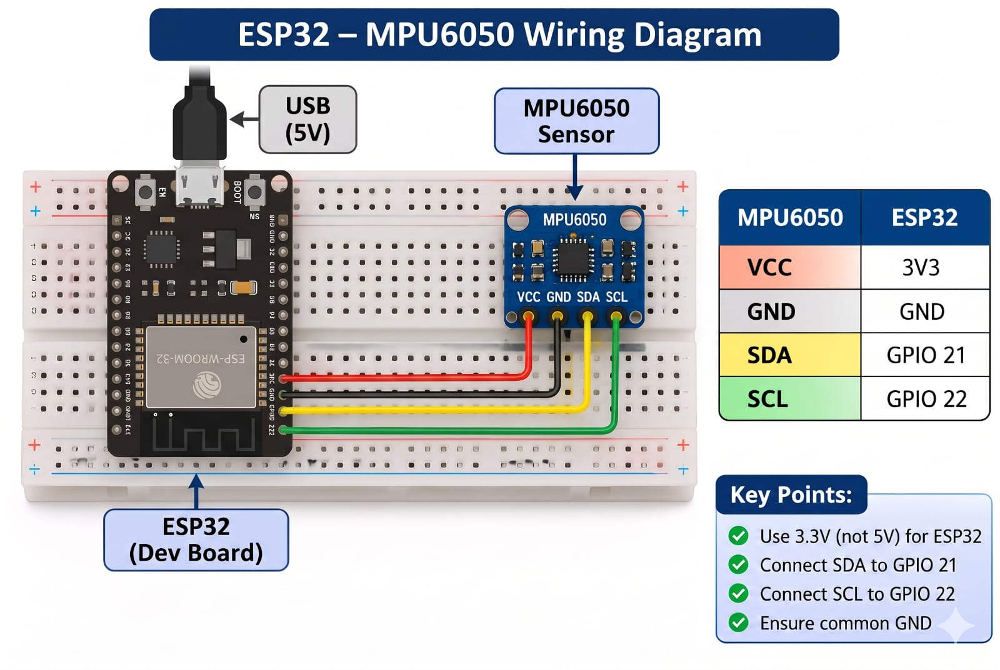
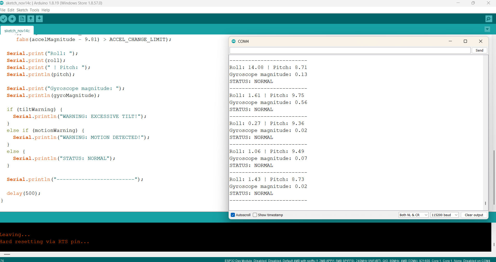
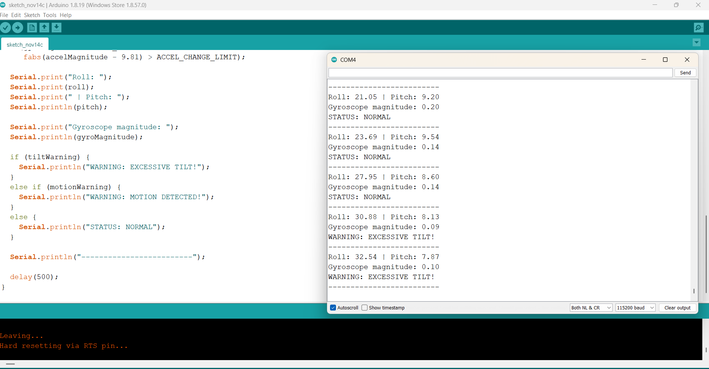
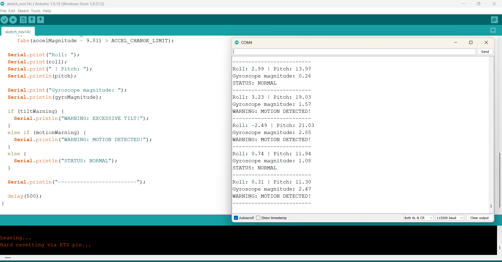

# Task 2: Embedded Sensor Monitoring

## Project Overview
This task uses an ESP32 microcontroller and an MPU6050 sensor to monitor tilt and motion.

## Components Used
- ESP32 development board
- MPU6050 accelerometer and gyroscope
- Breadboard
- Jumper wires
- USB cable

## Board Details

- Board: DOIT ESP32 DEVKIT V1
- Sensor: MPU6050
- Communication: I2C
- SDA: GPIO 21
- SCL: GPIO 22
- Sensor supply voltage: 3.3V

## Required Libraries

- Wire (built-in Arduino library)
- Adafruit MPU6050
- Adafruit Unified Sensor

## Installation and Setup

1. Install Arduino IDE.
2. Install the ESP32 board package.
3. Install the required libraries mentioned above.
4. Connect the ESP32 to your computer using a USB cable.
5. Select DOIT ESP32 DEVKIT V1 in Arduino IDE.
6. Select the correct COM port.
7. Upload the `esp32_mpu6050.ino` code.
8. Open Serial Monitor at 115200 baud.

## Connections

| MPU6050 | ESP32 |
|---|---|
| VCC | 3V3 |
| GND | GND |
| SDA | GPIO 21 |
| SCL | GPIO 22 |

## Working
The MPU6050 measures acceleration and angular velocity. The ESP32 reads these values through I2C and calculates roll and pitch angles.

The program displays sensor readings on the Serial Monitor and generates warnings when excessive tilt or motion is detected.

## Wiring Diagram

## Thresholds
- Tilt limit: 30 degrees
- Gyroscope limit: 1.2 rad/s
- Acceleration change limit: 3.0 m/s²

These are initial experimental thresholds for demonstration.

## Files
- `esp32_mpu6050.ino` – ESP32 firmware source code.
- `wiring_diagram.png.jpeg` – ESP32 and MPU6050 wiring diagram.

## Test Summary

| Test Condition | Expected Output |
|---|---|
| Sensor stationary | STATUS: NORMAL |
| Sensor tilted beyond 30° | WARNING: EXCESSIVE TILT! |
| Sensor moved | WARNING: MOTION DETECTED! |

## Test Evidence

### 1. Normal Status

### 2. Excessive Tilt Warning

### 3. Motion Detection Warning

